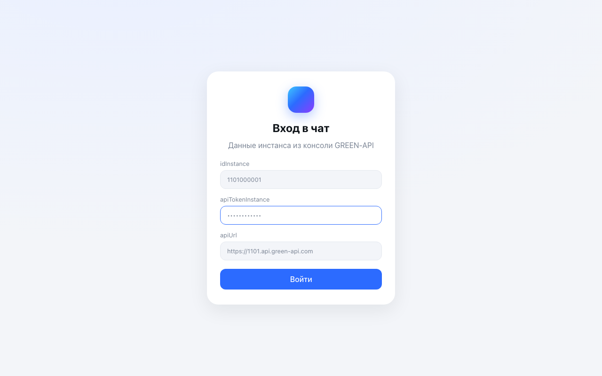
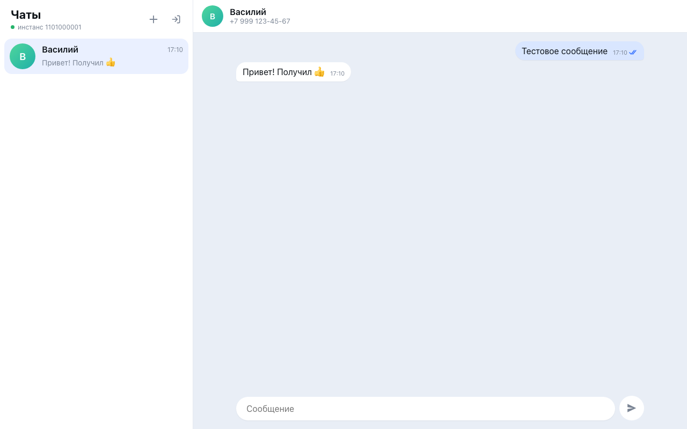
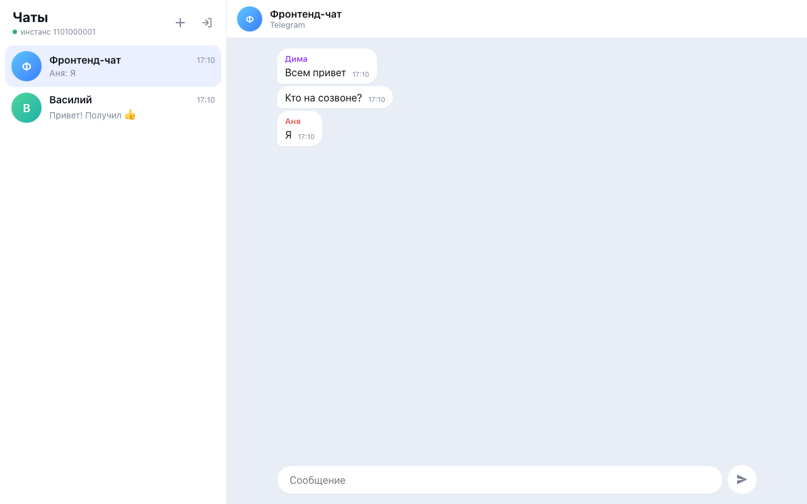
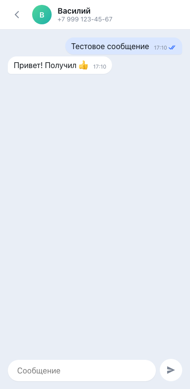

# GREEN-API Чат (Telegram)

Тестовое задание «Фронтенд-разработчик React» для GREEN-API: веб-чат для отправки и получения
текстовых сообщений через [GREEN-API](https://green-api.com/). По ТЗ допускается Telegram вместо MAX,
поэтому чат работает с **Telegram-инстансом**. Интерфейс сделан по образцу [web.max.ru](https://web.max.ru/).

**Демо:** https://testgreenapi.riakovlev.ru

## Что умеет

1. Вход по учётным данным инстанса: `idInstance`, `apiTokenInstance` (`apiUrl` подставляется из
   первых 4 цифр `idInstance`, его можно поправить). Перед входом проверяется, что инстанс в статусе
   `authorized` ([GetStateInstance](https://green-api.com/telegram/docs/api/account/GetStateInstance/)).
2. Новый чат по номеру телефона получателя. Telegram адресует чаты по `chatId`, поэтому номер
   сначала превращается в `chatId` через [CheckAccount](https://green-api.com/en/telegram/docs/api/service/CheckAccount/).
3. Отправка текста через [SendMessage](https://green-api.com/v3/docs/api/sending/SendMessage/).
   Enter отправляет, Shift+Enter переносит строку.
4. Получение через [HTTP API](https://green-api.com/v3/docs/api/receiving/technology-http-api/):
   long-poll `ReceiveNotification` (таймаут 20 с) → обработка → `DeleteNotification`.
   Ответ собеседника появляется в ленте. Если пишет новый собеседник, его чат создаётся сам.
5. Мелочи, без которых чат выглядит сломанным: галочки статусов (отправлено / доставлено /
   прочитано), счётчик непрочитанных, имя автора во входящих из групп, имя собеседника из Telegram вместо номера, индикатор
   «нет связи» с переподключением, мобильная раскладка, тёмная тема по системной настройке.

Учётка и история хранятся только в `localStorage` браузера, бэкенда у приложения нет:
запросы идут напрямую в API GREEN-API (CORS разрешён).

## Подготовка инстанса

1. В [консоли GREEN-API](https://console.green-api.com) создайте инстанс **Telegram** и авторизуйте его.
2. В настройках инстанса включите получение уведомлений о входящих и исходящих сообщениях и
   их статусах. Поле **URL для уведомлений оставьте пустым**: при заданном webhook
   `ReceiveNotification` не работает.
3. Скопируйте `idInstance` и `apiTokenInstance` из консоли.

## Локальный запуск

Нужен Node.js 20+.

```bash
git clone https://github.com/fellz/testgreenapi.git
cd testgreenapi
npm install
npm run dev          # http://127.0.0.1:5216
```

Сборка статики: `npm run build` → папка `dist/`.

## Проверки

```bash
npm test             # vitest: разбор уведомлений, редьюсер чатов, нормализация номера
npm run lint         # oxlint
npm run build        # tsc + vite build
```

E2E-сценарий из ТЗ (вход → новый чат → отправка → ответ в ленте) на Playwright, с подменой
API GREEN-API, поэтому реальный инстанс для него не нужен:

```bash
npm run build && npx vite preview &          # http://127.0.0.1:5217
node e2e/chat.mjs                            # нужен playwright (npm i -g playwright)
```

Скриншоты прогона сохраняются в `e2e/shots/`.

## Устройство

```
src/
  api/greenApi.ts         клиент: getStateInstance, checkAccount, sendMessage, receive/deleteNotification
  api/notifications.ts    тело уведомления → событие чата (текст входящий/исходящий, статус)
  api/useNotifications.ts цикл long-poll с backoff при ошибках сети
  api/phone.ts            нормализация номера (+7 / 8 / пробелы → 79991234567)
  state/chats.ts          чистый редьюсер чатов: дедуп эха API, статусы только растут
  state/storage.ts        localStorage
  components/             Login, Sidebar (+ новый чат), ChatView, Avatar
```

Отправленное сообщение сразу попадает в ленту со статусом «отправляется». После ответа
`SendMessage` оно получает настоящий `idMessage`. Эхо `outgoingAPIMessageReceived` из очереди
склеивается с ним по `idMessage`, даже если пришло раньше ответа `SendMessage`.

## Скриншоты

| Вход | Чат | Группа | Телефон |
|---|---|---|---|
|  |  |  |  |
